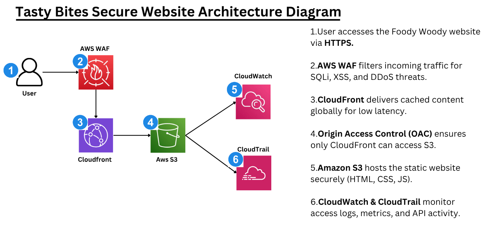
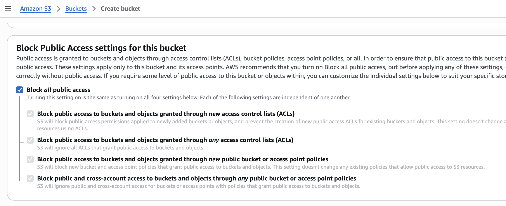
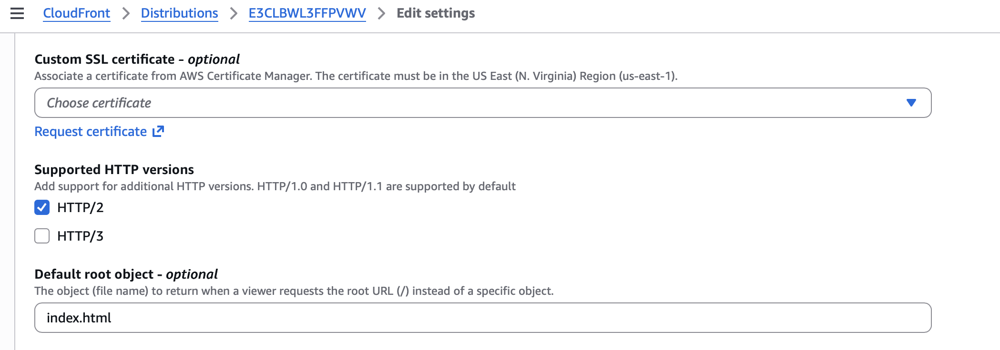
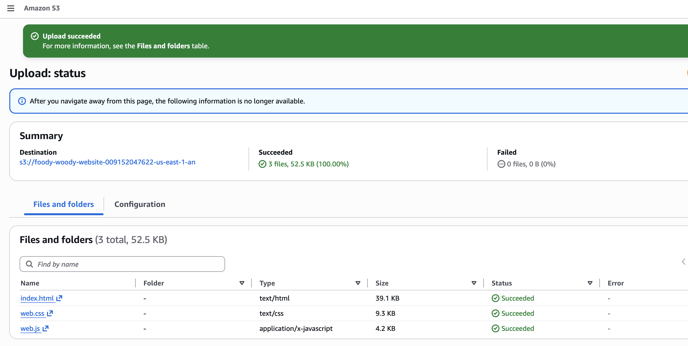
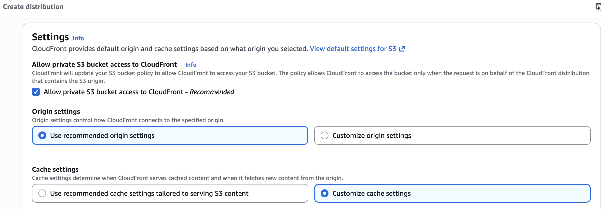
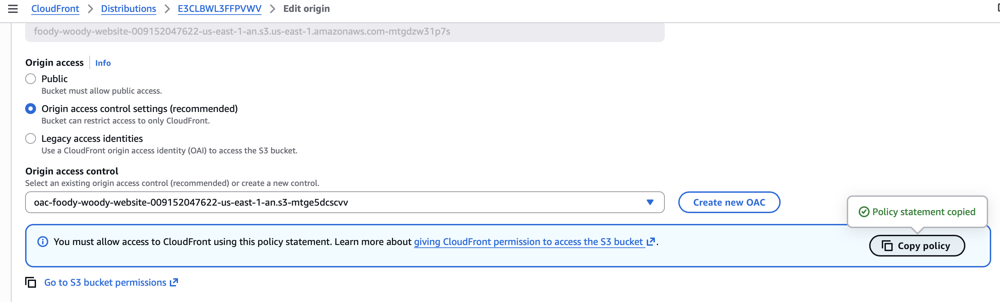
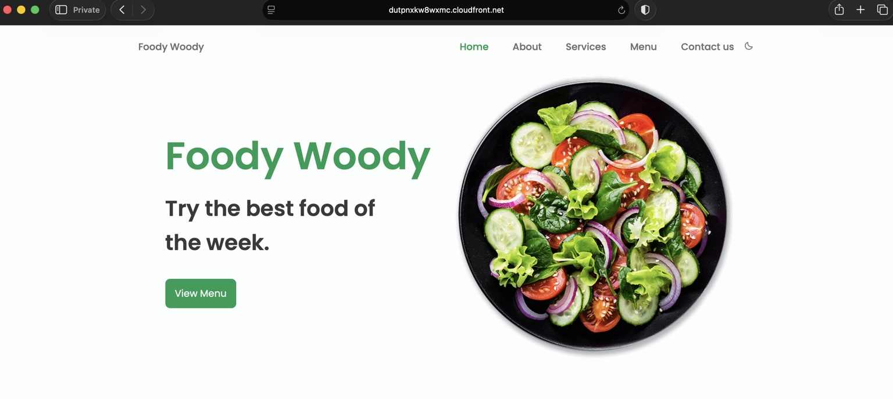

# Foody Woody - Secure Serverless Website on AWS

A personal AWS cloud security project documenting how I built a static restaurant website around a private Amazon S3 origin, delivered it through Amazon CloudFront, and placed AWS WAF in front of the distribution to reduce direct exposure and filter common malicious web requests.

This repository is documentation of a hands-on cloud security lab, not a software product. The focus is the security architecture, the controls I configured, and the evidence I captured while validating them.

**Region used:** `us-east-1` (N. Virginia) for the S3 workload  
**Scenario:** Foody Woody, a restaurant website serving static HTML, CSS, and JavaScript  
**Project type:** Personal cloud security / serverless architecture lab  
**Status:** Completed

---

## Architecture



The design keeps the S3 bucket private and makes CloudFront the public delivery layer. Origin Access Control (OAC) authorizes the CloudFront distribution to retrieve objects from S3 without making the bucket publicly readable. AWS WAF is associated with CloudFront so requests can be inspected at the edge before the protected content is returned.

### Primary request path

`Internet user → AWS WAF → Amazon CloudFront → OAC → private Amazon S3 bucket`

IAM supports administrative access control, while CloudWatch, CloudTrail, and AWS Config are documented as monitoring and compliance controls that would strengthen a production implementation. They were not separately validated as part of the captured hands-on evidence in this lab.

---

## Project goal

The goal was to host a simple static website without treating “static” as synonymous with “safe.” A public S3 bucket would have been easy to configure, but it would also create unnecessary direct exposure. Instead, I wanted the public entry point and the storage layer to have different trust boundaries.

The project was built around one practical question:

> How can a static website remain globally accessible while keeping its origin private and adding application-layer filtering in front of it?

The answer was a layered design: private object storage in S3, controlled origin access through CloudFront OAC, HTTPS delivery through CloudFront, and AWS WAF managed rules for request inspection.

---

## Implemented architecture

### Private S3 origin

The website files (`index.html`, `web.css`, and `web.js`) were stored in Amazon S3 with **Block Public Access enabled**. The bucket itself was not used as a public website endpoint.

This matters because the website can still be public without making the storage service public. Users interact with CloudFront; CloudFront retrieves the required objects from S3 under the OAC-based bucket policy.



Full walkthrough: [`docs/02-secure-s3-hosting.md`](docs/02-secure-s3-hosting.md)

### CloudFront + Origin Access Control

CloudFront was configured with the S3 bucket as its origin. Private origin access was enabled using **Origin Access Control (OAC)**, and the generated S3 bucket policy was applied so the CloudFront distribution could retrieve objects without opening the bucket to anonymous internet access.

The default behavior redirects HTTP requests to HTTPS, allows the read-oriented `GET` and `HEAD` methods needed by this static site, and uses CloudFront caching. `index.html` was configured as the default root object.



Full walkthrough: [`docs/03-cloudfront-and-oac.md`](docs/03-cloudfront-and-oac.md)

### AWS WAF

A Web ACL was associated with the CloudFront distribution. The captured configuration includes AWS managed rule groups for common web threats, known bad inputs, and IP reputation-based filtering.

The WAF layer gives the public endpoint a place to inspect and block suspicious requests before they reach the origin path.


Full walkthrough: [`docs/04-waf-and-validation.md`](docs/04-waf-and-validation.md)

---

## Main security controls

- S3 Block Public Access enabled
- No public S3 website endpoint used as the CloudFront origin
- CloudFront as the public content-delivery layer
- Origin Access Control restricting S3 origin access to CloudFront
- HTTP redirected to HTTPS at CloudFront
- Static-site behavior limited to `GET` and `HEAD`
- AWS WAF associated with the CloudFront distribution
- AWS managed WAF rule groups for common threats, known bad inputs, and IP reputation
- Dedicated non-root AWS access model and MFA documented as IAM best practice
- CloudWatch, CloudTrail, and AWS Config identified as monitoring/audit/compliance controls for production hardening

---

## Validation results

The configuration was validated with AWS Console and browser evidence rather than relying only on the intended design.

### Website files stored in S3



### Private origin access configured



### OAC bucket policy applied



### Website delivered through CloudFront over HTTPS



### WAF associated with CloudFront


### Malicious request blocked

A deliberately suspicious query containing an XSS-style `<script>` payload was sent to the CloudFront URL. The request returned **HTTP 403 Forbidden**, providing direct evidence that the WAF layer was actively blocking the test request.


All captured evidence: [`docs/10-evidence-index.md`](docs/10-evidence-index.md)

---

## Security design summary

| Security area | Design used in this project |
| --- | --- |
| Origin storage | Private Amazon S3 bucket |
| Public access to S3 | Blocked |
| Content delivery | Amazon CloudFront |
| Origin authorization | CloudFront Origin Access Control |
| Client transport | HTTP redirected to HTTPS |
| Web request filtering | AWS WAF |
| WAF rules | AWS managed rule groups |
| Administrative access | Non-root IAM model; MFA documented |
| Monitoring / audit | CloudWatch, CloudTrail, Config documented as production controls |

The most important design decision was not simply “adding WAF.” It was separating the public delivery layer from the storage layer. WAF then adds another defensive layer on top of that reduced-exposure architecture.

---

## IAM security

Day-to-day AWS administration should not be performed through the root account. A dedicated IAM identity, MFA, and permissions scoped to the work being performed are the appropriate model for managing this type of environment.

For this project, IAM is documented as an architectural security control rather than presented as a separately evidenced deployment step. In a production environment, I would prefer narrowly scoped customer-managed policies or role-based access instead of broad `FullAccess` managed policies wherever practical.

See [`docs/05-iam-security.md`](docs/05-iam-security.md).

---

## Monitoring and compliance

A production version of this architecture should also provide visibility into activity and configuration drift. CloudWatch can support operational metrics, logs, dashboards, and alarms; CloudTrail provides an audit trail of AWS API activity; and AWS Config can evaluate resource configuration against desired rules.

These services are included in the architecture discussion because they are relevant to operating the environment securely, but this repository does **not** present them as controls that were independently implemented and validated during the captured lab.

See [`docs/06-monitoring-and-compliance.md`](docs/06-monitoring-and-compliance.md).

---

## Repository structure

```text
foody-woody-secure-aws-website/
├── README.md
├── .gitignore
├── LICENSE
├── assets/
│   ├── architecture/
│   │   └── foody-woody-architecture-diagram.png
│   └── evidence/
│       ├── s3/
│       ├── cloudfront/
│       └── waf/
└── docs/
    ├── 01-project-overview.md
    ├── 02-secure-s3-hosting.md
    ├── 03-cloudfront-and-oac.md
    ├── 04-waf-and-validation.md
    ├── 05-iam-security.md
    ├── 06-monitoring-and-compliance.md
    ├── 07-security-architecture.md
    ├── 08-limitations-and-production-hardening.md
    ├── 09-cleanup.md
    └── 10-evidence-index.md
```

---

## Documentation

- [`Project overview`](docs/01-project-overview.md)
- [`Secure S3 hosting`](docs/02-secure-s3-hosting.md)
- [`CloudFront and OAC`](docs/03-cloudfront-and-oac.md)
- [`AWS WAF and validation`](docs/04-waf-and-validation.md)
- [`IAM security`](docs/05-iam-security.md)
- [`Monitoring and compliance`](docs/06-monitoring-and-compliance.md)
- [`Security architecture`](docs/07-security-architecture.md)
- [`Limitations and production hardening`](docs/08-limitations-and-production-hardening.md)
- [`Cleanup`](docs/09-cleanup.md)
- [`Evidence index`](docs/10-evidence-index.md)

---

## What this project demonstrates

This project demonstrates more than hosting a few files in S3. It shows how I think about trust boundaries in a small AWS workload: keep the origin private, expose only the delivery layer that users actually need, authorize service-to-service access explicitly, encrypt traffic to viewers, place request filtering at the edge, and validate that the security control changes real request behavior.

It also reinforced an important cloud security lesson: a service does not need to be publicly reachable just because the application it supports is public.

---

## Important limitations

This is a personal hands-on lab, not a full production restaurant platform. In particular:

- No custom domain or ACM-managed certificate was configured; the CloudFront domain and its HTTPS endpoint were used.
- The website is static and does not include a backend API, database, authentication flow, or real customer-review submission system.
- WAF validation captured an XSS-style malicious query returning `403`; the repository does not claim exhaustive SQL injection, bot, rate-limit, or DDoS testing.
- AWS Shield Standard is part of AWS's baseline DDoS protection for supported services, but no separate Shield-specific configuration or attack simulation was performed.
- CloudWatch alarms, CloudTrail trail configuration, AWS Config rules, Security Hub, and GuardDuty were not independently implemented and validated in the captured lab.
- IAM best practices are documented, but this repository does not use screenshots as evidence of a project-specific IAM-user build.
- No WAF rate-based rule or custom application-specific WAF rule was validated.
- No CI/CD pipeline or infrastructure-as-code deployment was implemented.

These are documented as production-hardening opportunities rather than represented as completed controls.

---

## Cleanup

After validation, the lab resources were removed to avoid unnecessary ongoing charges. The cleanup sequence was:

1. Disable the CloudFront distribution.
2. While CloudFront was disabling, disassociate the Web ACL and delete the WAF configuration.
3. Empty and delete the S3 bucket.
4. Remove the IAM user/group associated with the lab where applicable.
5. Delete the CloudFront distribution after it reached the disabled state.

Full cleanup notes: [`docs/09-cleanup.md`](docs/09-cleanup.md)

---

## Author

**Neel Moradiya**  
Personal AWS cloud security project
