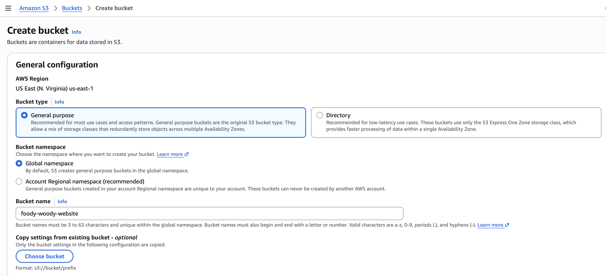

# 02 - Secure S3 Hosting

## Why S3 was used

Foody Woody is a static website, so it does not require an always-running web server simply to return HTML, CSS, and JavaScript. Amazon S3 provides durable object storage that fits this workload well.

The security decision was to use S3 as an **origin**, not as a directly public website endpoint.

## Bucket configuration

A dedicated S3 bucket was created in `us-east-1`. The website files uploaded to the bucket were:

- `index.html`
- `web.css`
- `web.js`

### Block Public Access

S3 Block Public Access remained enabled. This is a key part of the design because anonymous users do not need direct permission to retrieve objects from the bucket.

The site is public at the **CloudFront layer**, while the storage origin remains private. That distinction reduces unnecessary exposure and makes the intended access path easier to reason about.

### Website objects

The static files were uploaded successfully and became the content served by the CloudFront distribution.

## Security outcome

The bucket was not intentionally opened for anonymous public reads. Instead, the next stage of the project authorized CloudFront to retrieve the objects through Origin Access Control.

This pattern is stronger than making the bucket public simply because the website itself must be reachable from the internet. Public application access and public origin access are separate requirements, and this project intentionally separates them.
