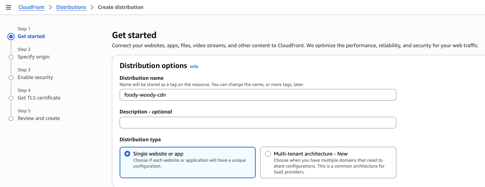
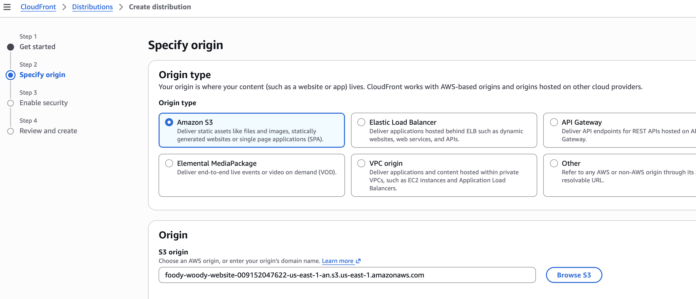
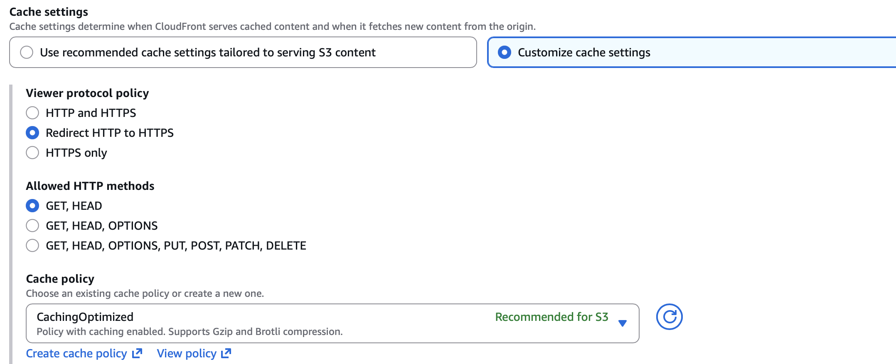
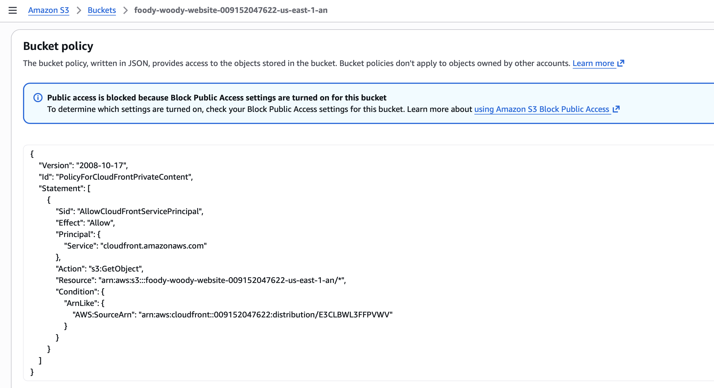

# 03 - CloudFront and Origin Access Control

## Why CloudFront sits in front of S3

CloudFront is the public delivery layer for the project. It provides edge caching, an HTTPS endpoint, and a controlled path to the private S3 origin.

Rather than selecting an S3 static-website endpoint, the distribution uses the S3 bucket origin so private origin access can be enforced.

## Distribution configuration

A CloudFront distribution was created for the Foody Woody website and the S3 bucket was selected as its origin.

## Origin Access Control

Private S3 access was enabled for CloudFront through Origin Access Control (OAC).

OAC changes the trust relationship between the services: visitors do not receive S3 permissions. CloudFront is the service authorized to retrieve the required objects from the origin.

The generated policy was then applied to the S3 bucket so the distribution could access the objects under the expected service relationship.

## Viewer behavior

The default CloudFront behavior was configured for the static workload. Viewer HTTP requests are redirected to HTTPS, and the read-oriented `GET` and `HEAD` methods are sufficient for the website content.

The default root object was set to `index.html`, allowing the CloudFront domain root to load the site's home page without requiring `/index.html` in the browser address.

## Deployment and validation

Once deployed, the distribution became the public endpoint for the site.

The final browser validation confirmed that Foody Woody loaded successfully through the CloudFront HTTPS URL.

## Security outcome

The important result is not only faster content delivery. The architecture avoids giving users a direct public S3 path. CloudFront handles public requests, while OAC provides the controlled origin-access mechanism behind it.
