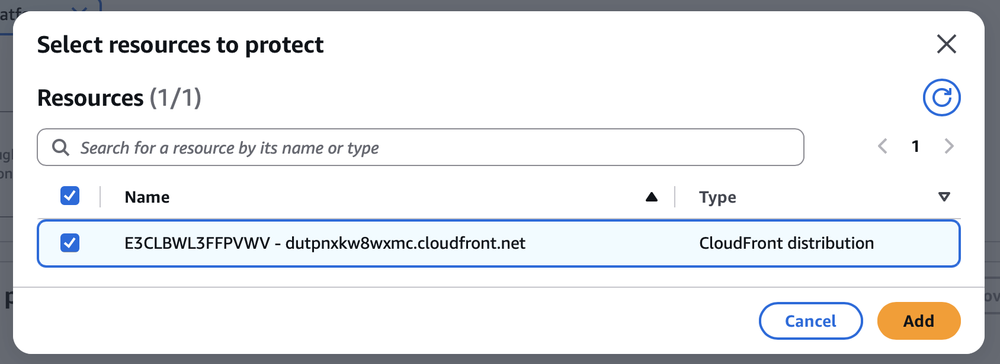
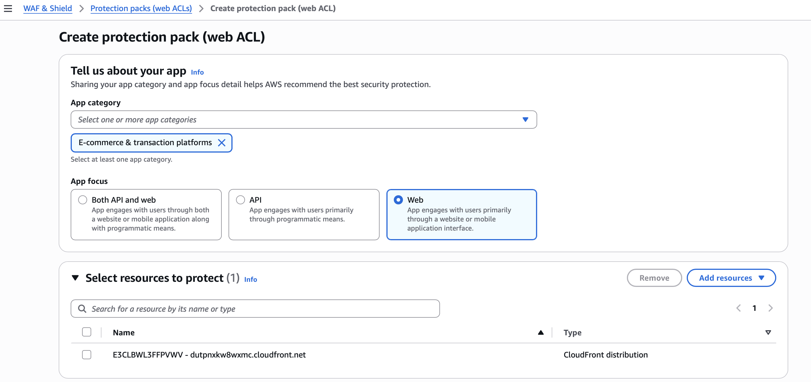
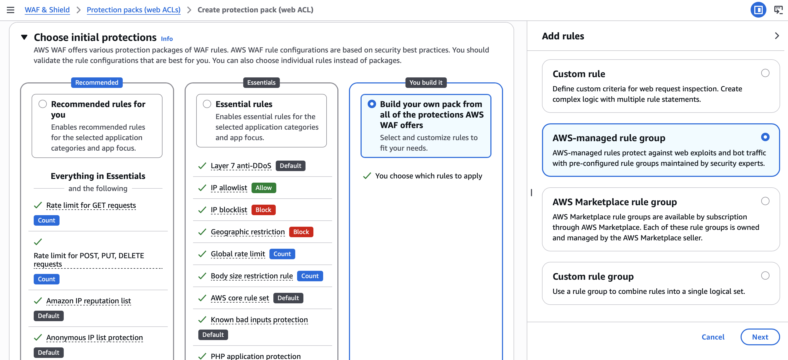
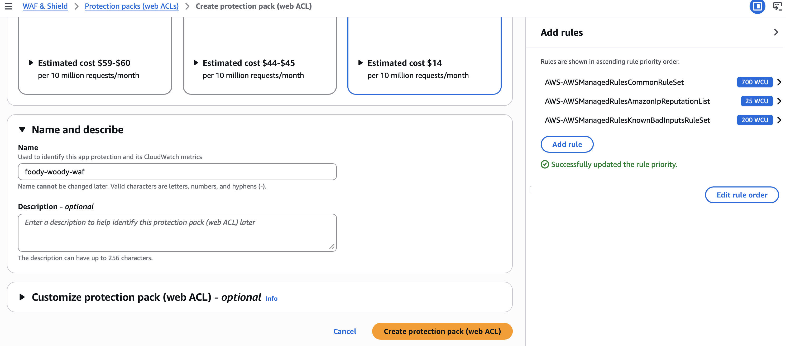
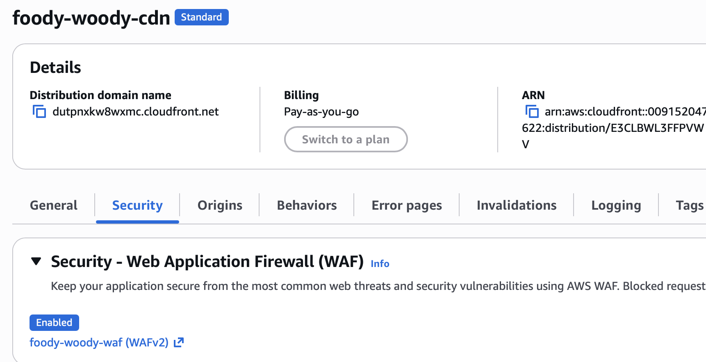
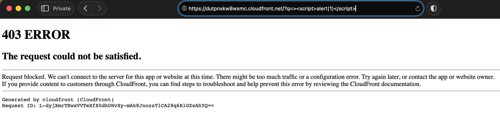

# 04 - AWS WAF and Validation

## Purpose of the WAF layer

After the CloudFront delivery path was working, AWS WAF was added to inspect requests before the protected content was returned through the distribution.

WAF is useful here because a private origin does not by itself determine whether a request is malicious. The origin-access control and the web-application firewall solve different problems: OAC protects the S3 trust boundary, while WAF evaluates viewer requests.

## Web ACL association

The CloudFront distribution was selected as the resource protected by the Web ACL.

## AWS managed rules

The captured configuration includes AWS managed rule groups rather than a large set of custom signatures. This provides a practical baseline for a small lab while keeping rule maintenance with AWS.

The configured rule groups shown in the project evidence include:

- `AWSManagedRulesCommonRuleSet`
- `AWSManagedRulesAmazonIpReputationList`
- `AWSManagedRulesKnownBadInputsRuleSet`

The Web ACL was then created and associated with CloudFront.

CloudFront's security view confirmed that WAF protection was enabled for the distribution.

## Validation test

A normal website request continued to load successfully through CloudFront. To validate blocking behavior, I then sent a deliberately suspicious query containing an XSS-style `<script>` payload to the CloudFront URL.

The request returned:

`403 Forbidden`

This is stronger evidence than simply showing that a Web ACL exists. It demonstrates that, for the captured test case, the request path produced an actual blocking response.

## Scope of the result

The test confirms the observed `403` response for the malicious XSS-style query shown in the evidence. It should not be interpreted as a claim that every SQL injection, XSS, bot, application-abuse, or DDoS scenario was exhaustively tested.

A production WAF policy would normally be tuned using application traffic, logs, false-positive analysis, rate-based controls, and application-specific rules rather than relying on a single test request.
